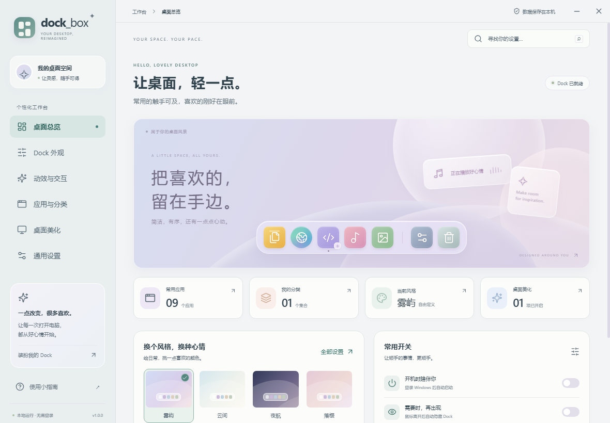
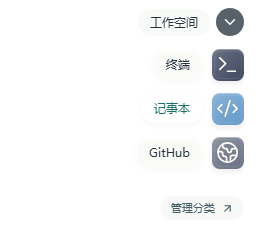
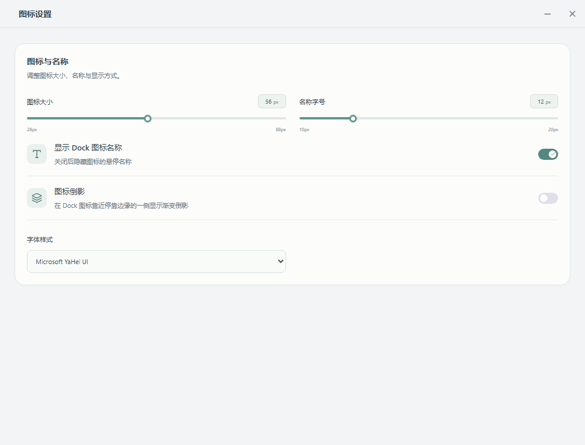

<div align="center">


# dock_box

**让常用应用留在手边，让 Windows 桌面轻一点。**

一款可自定义的 Windows 桌面 Dock，支持应用分类、透明堆叠列表与桌面美化。配置保存在本机，无需账号。

[](https://github.com/futao-awa/Dock_box/actions/workflows/windows.yml)
[](#系统要求)
[](LICENSE)

[快速开始](#快速开始) · [功能](#功能一览) · [开发](#开发与构建) · [更新记录](CHANGELOG.md) · [参与贡献](CONTRIBUTING.md)

</div>



## 为什么使用 dock_box

把应用、文件夹和网址集中到一个入口，按用途整理成分类。Dock 可以停靠在屏幕四边，在需要时出现；控制中心提供实时预览，让外观、位置和交互调整更直观。

Windows 集成通过独立的 C# 原生组件完成，支持 Shell 启动、任务栏样式、桌面图标切换和屏幕圆角。所有系统美化默认关闭，由你选择开启。

## 功能一览

| 能力 | 支持内容 |
| --- | --- |
| 应用启动 | 程序、快捷方式、商店应用、文件夹、网址及系统工具；支持中文路径、启动参数和工作目录 |
| 应用识别 | 扫描开始菜单、桌面与 Windows 应用库，自动读取名称和图标；保留自定义路径、图片作为回退 |
| 分类管理 | 透明堆叠列表、网格、普通列表、扇形四种布局；拖入文件、移动应用、排序和分隔线 |
| Dock 外观 | 四边停靠、显示器选择、缩放、图标大小、间距、偏移、透明度、圆角及四款主题 |
| 文字与图标 | 名称显示开关、字号、字体、自定义图标与图标倒影 |
| 交互与恢复 | 波浪放大、悬停浮起、点击动效、自动隐藏、触发条颜色、置顶与减少动态效果；右键刷新 Dock |
| 快捷管理 | 右键打开任务管理器、图标设置、添加应用和分类管理；管理入口使用独立窗口 |
| 桌面美化 | 桌面图标隐藏 / 中键切换、任务栏透明 / 磨砂 / 自定义颜色、屏幕圆角遮罩 |
| 设备与常驻 | U 盘检测、系统托盘、开机自启及可关闭的开机动画 |
| 本地数据 | 配置导入 / 导出、原子写入、损坏配置备份；可选 Windows 防火墙联网禁用 |

<details>
<summary>查看分类展开和独立图标设置</summary>

透明堆叠列表将名称放在左侧、图标对齐在右侧，窗口其余区域保持透明：



独立图标设置页：



截图来自实际 Electron 界面，透明区域会显示所在页面的背景。

</details>

## 系统要求

- **运行：** Windows 10 / Windows 11，x64。当前仅提供 Windows 桌面版构建目标。
- **开发：** Node.js 22.16 或更新版本、npm；Windows 构建还需要系统的 .NET Framework 4.x C# 编译器。
- **部分系统操作：** 联网禁用通过 Windows 防火墙实现，切换时需要 Windows 管理员授权。

任务栏效果依赖 Windows 版本及资源管理器行为。多屏、高 DPI、真实登录自启和硬件插拔需要在目标电脑验证，详见 [测试指南](TESTING.md)。

## 快速开始

### 获取应用

仓库提供源码和 [Windows 构建工作流](https://github.com/futao-awa/Dock_box/actions/workflows/windows.yml)。成功的构建会上传 `dock_box-windows-x64`，其中包含安装版和便携版；下载 Actions 附件通常需要登录 GitHub。也可以按下方步骤在本机构建。

| 产物 | 使用方式 |
| --- | --- |
| `dock_box-<版本>-x64-setup.exe` | 安装向导，可选择安装目录并创建桌面快捷方式 |
| `dock_box-<版本>-portable.exe` | 免安装便携版，双击运行 |
| `release/win-unpacked/` | 完整解包应用目录，用于开发验证 |

更新前退出正在运行的旧版本，再运行新版本。配置默认会沿用，迁移前可以先导出备份。

### 整理你的 Dock

1. 首次运行会显示控制中心和 Dock。在“应用与分类”点击“添加应用”，选择自动识别的应用。
2. 没有识别到的程序可使用“自定义路径”，也可以把快捷方式直接拖到 Dock；图标支持自定义图片。
3. 新建分类并移入应用，或把文件拖到分类图标中。在“动效与交互 → 分类展开方式”选择布局。
4. 在“Dock 外观”调整位置和主题，在“通用设置 → 管理面板”设置设备、启动方式和网络权限。

已有配置会保留原分类布局；升级后如需参考截图中的效果，请选择 **透明堆叠列表**。

### 常用操作

| 操作 | 入口 |
| --- | --- |
| 打开控制中心 | `Ctrl + Shift + D`、双击托盘图标，或右键 Dock |
| 添加应用 / 管理分类 / 图标设置 | Dock 右键菜单或控制中心 |
| Dock 卡住时重新加载 | 右键“刷新 Dock” |
| 关闭分类 | `Esc`、分类关闭按钮，或再次点击分类图标 |
| 打开任务管理器 | Dock 右键菜单 |
| 完全退出 | Dock / 托盘的“退出 dock_box”，或通用设置中的退出按钮 |

关闭控制中心后，Dock 会继续运行。

## 配置与系统行为

配置位于 `%APPDATA%\dock_box\config.json`，应用路径和自定义图标也保存在这里。便携版使用相同的本机配置目录。通过通用设置中的导入 / 导出功能可以迁移外观和应用列表，导入时会保留本机的系统集成开关。

正常退出及原生组件输入管道断开时，程序会恢复本次运行前的桌面图标可见性，释放任务栏效果并移除圆角遮罩。若原任务栏 Accent 可以读取则恢复该样式；无法读取时会清除自定义 Accent，并通知资源管理器重新应用 Windows 系统主题。其他任务栏美化工具的样式不能保证完整恢复。

“禁止 dock_box 联网”会拦截应用自身的网络请求，并为相关程序路径创建 Windows 防火墙入站 / 出站阻止规则。规则在退出后继续生效，关闭开关会移除本程序创建的规则。便携版移动路径后，需要授权更新规则；更新失败时会在管理面板显示提示。通过 Dock 打开的浏览器或其他应用使用各自的网络权限。

便携版开启自启后应保持 EXE 路径稳定；移动后请重新设置自启。屏幕圆角使用可穿透点击的黑色遮罩，不改变显示器分辨率或物理边界。

## 开发与构建

```powershell
git clone https://github.com/futao-awa/Dock_box.git
cd Dock_box
npm ci
npm run dev
```

仅在浏览器预览控制中心：`npm run dev:web`。预览不提供文件选择、真实应用启动或 Windows 系统美化操作。

| 命令 | 用途 |
| --- | --- |
| `npm run typecheck` | TypeScript 类型检查 |
| `npm test` | 配置、布局、持久化、启动目标和联网策略单元测试 |
| `npm run build` | 构建前端、Electron 和 Windows 原生组件 |
| `npm start` | 启动已构建的应用 |
| `npm run test:desktop` | 使用隔离配置执行 Electron 桌面回归 |
| `npm run test:launch` | 用本地测试程序验证真实 Windows Shell 启动 |
| `npm run test:native` | 可选的交互式桌面图标切换 / 恢复测试 |
| `npm run pack:win` | 生成 Windows 解包应用 |
| `npm run dist:win` | 生成 x64 安装版、便携版和解包应用 |

```powershell
npm test
npm run build
npm run test:launch
npm run test:desktop
npm run dist:win
npm run test:desktop -- --exe release/win-unpacked/dock_box.exe
```

构建脚本使用 Windows 自带的 .NET Framework 编译器，无需安装完整 Visual Studio。输出位于 `dist/`、`dist-electron/`、`resources/native/` 和 `release/`；这些生成文件、依赖与测试配置均不提交到 Git。

### 下载源不可达时

可在当前 PowerShell 会话设置 Electron 下载镜像，安装工具仍会执行摘要校验：

```powershell
$env:ELECTRON_MIRROR = 'https://npmmirror.com/mirrors/electron/'
$env:ELECTRON_BUILDER_BINARIES_MIRROR = 'https://npmmirror.com/mirrors/electron-builder-binaries/'
npm ci
npm run dist:win
```

## 验证范围

当前版本通过 27 项单元测试、TypeScript 检查、生产构建与打包应用回归。真实 Shell 测试验证了 EXE 和快捷方式启动，覆盖中文、空格、参数及工作目录。

桌面回归覆盖设置导航、透明背景、四种分类布局、分类启动请求、应用与图标识别、独立管理窗口、Dock 刷新以及配置导入 / 导出和重启保存。它使用隔离配置，抑制外部应用实际启动和系统修改；因此不能替代任务栏、屏幕圆角、多屏、U 盘插拔、开机自启及防火墙授权的实机验收。详细步骤见 [TESTING.md](TESTING.md)。

## 架构与目录

| 目录 | 职责 |
| --- | --- |
| `src/` | React 控制中心、独立管理页、Dock 与分类窗口 |
| `electron/` | 窗口、IPC、配置、启动目标校验与原生桥接 |
| `native/` | C# Win32 / Shell / 防火墙组件 |
| `shared/` | 共享配置模型、边界校验和布局计算 |
| `scripts/` | 构建、图标生成与桌面 / 原生回归 |
| `tests/` | Vitest 单元测试 |
| `docs/` | 架构说明、更新详情和真实界面截图 |

界面使用 React 19 和 Vite，桌面宿主使用 Electron 40；Windows 原生组件通过 UTF-8 JSON 管道与主进程通信。详见 [架构说明](docs/ARCHITECTURE.md)。

## 反馈与贡献

遇到问题请使用 [Bug 模板](https://github.com/futao-awa/Dock_box/issues/new?template=bug_report.yml)，附上版本、Windows 版本、缩放比例和复现步骤。功能建议可使用 [建议模板](https://github.com/futao-awa/Dock_box/issues/new?template=feature_request.yml)。分享截图或导出的配置前，请移除私人路径和网址。

提交代码前请阅读 [贡献指南](CONTRIBUTING.md)。安全问题的报告方式见 [SECURITY.md](SECURITY.md)。

## 许可证

[MIT License](LICENSE) · Copyright © 2026 [futao-awa](https://github.com/futao-awa)。
