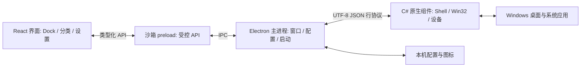

# 架构说明

## 进程与窗口

主进程创建透明 Dock 和分类窗口，以及不透明控制中心 / 管理窗口。分类收起时隐藏并保留窗口，下次展开通过 hash 路由更新内容；刷新 Dock 时销毁并重建 Dock 与分类窗口。

渲染进程通过 preload 的 `window.dockBox` API 请求操作，不直接访问 Node.js。主进程确认请求来自本应用窗口的主 frame，随后执行配置校验或系统调用。窗口禁止任意导航和弹出新网页，真实网址通过系统浏览器打开。

## 配置与状态

`shared/model.ts` 定义配置、默认值、支持选项和数值范围。`electron/store.ts` 读取与规范化配置，写入临时文件后重命名；损坏文件保留为 `.corrupt-*` 副本。配置版本目前为 `1`，新增设置通过默认值补齐。

主进程保存配置后向窗口广播状态。系统设置合并后延迟应用，避免连续调整滑块反复调用原生接口。导入配置保留自启、托盘、桌面美化、网络等本机系统集成选择。

U 盘入口由设备状态生成，不写入应用列表；拔出或关闭检测后移除。程序配置和图标数据默认位于 `%APPDATA%\dock_box`，回归测试使用 `DOCK_BOX_PROFILE` 指定的隔离目录。

## 应用识别与启动

应用扫描异步读取开始菜单和桌面快捷方式，并把路径交给 C# STA worker 解析真实目标、快捷方式参数、工作目录和 Shell 图标；同时合并 `shell:AppsFolder`、App Paths 和已安装程序登记信息。应用库按真实目标与参数去重，再分为常用应用、系统工具、网页和全部入口；帮助页、卸载程序、失效入口不会混入默认常用视图。扫描结果缓存，可在应用库重新扫描。

`electron/launch.ts` 校验目标：网址仅允许 HTTP / HTTPS；文件路径支持环境变量、中文和空格；系统工具使用 Windows 系统目录；商店应用使用 AppsFolder 标识。

默认启动路径是 C# `ProcessStartInfo.UseShellExecute`，交由 Windows 处理 `.lnk`、程序、文件夹和网址。原生输入输出显式使用 UTF-8，快捷方式本身的参数与工作目录由 Windows 保留。原生组件不可用或关闭系统接口启动时，主进程使用 Electron Shell 回退。

BitDock 迁移只读取用户主动选择或自动定位到的 `Data/BitDock.xml`、`ico*.xml` 和 `config.ini`。XML 禁止 DTD / 外部实体，解析后限制层级和项目数量；`MENU` 变为分类，`ICON` / `FOLDER` / 系统入口映射为 Dock 项目，本地自定义图标转为 data URL。导入预览带有令牌，确认时写入当前配置备份，并可追加或替换；U 盘和 BitDock 专属动态菜单会说明后跳过。

Dock 波浪由 `shared/wave.ts` 计算连续布局：每个图标按鼠标距离获得缩放，相邻项目通过 flex 宽度让位，分隔线保留固定宽度；布局根据窗口剩余空间限长，离开 Dock 后通过 requestAnimationFrame 平滑复位。主进程的 Dock 窗口预留最大波峰尺寸，避免放大时被窗口边界裁切。

## Windows 集成与恢复

原生组件使用 WinForms 消息循环处理请求，周期性刷新任务栏效果、圆角置顶、显示器变化和可移动磁盘。桌面中键功能使用低级鼠标钩子，仅在桌面区域切换图标可见性。

任务栏使用 Accent，Windows 11 的 Backdrop 会先调整以避免遮盖效果。退出时恢复可读取的旧 Accent；无法读取时清除自定义效果并通知资源管理器重建系统主题。圆角由独立、无激活、点击穿透的黑色分层窗口实现。

正常退出时主进程发送恢复请求并关闭输入管道；原生组件收到 EOF 后也执行恢复。定时器、鼠标钩子及遮罩随之释放。无法保证在原生组件被强制终止等情况下完成恢复，也不能保证还原无法读取的第三方任务栏效果。

## 网络开关

联网禁用包含两层：Chromium 请求拦截，以及按 EXE 路径建立的 Windows 防火墙入站 / 出站阻止规则。主进程通过提升权限的原生组件更新规则，UAC 由 Windows 显示。取消或更新失败时不保存新的开关值，并返回错误。

规则按程序路径生成名称，仅管理本程序创建的规则。路径记录保存在配置目录的 `firewall-programs.json`；关闭开关时一并移除记录的规则。便携应用路径变化会请求更新，失败时报告状态。规则属于持久设置，退出程序不自动解除联网禁用。

## 测试边界

- Vitest：配置边界、布局、分类操作、持久化、启动目标校验与请求拦截策略。
- Electron 回归：真实 preload、IPC、窗口路由和配置同步；系统修改及外部程序实际启动被抑制。
- Windows Shell 回归：创建本地临时 EXE 与快捷方式，验证真实启动、UTF-8 参数和工作目录。
- 交互式原生回归：短暂切换桌面图标并验证恢复。
- 人工验收：任务栏、圆角、不同 DPI / 显示器、U 盘硬件、自启及防火墙授权。

具体命令和操作矩阵见 [测试指南](../TESTING.md)。
